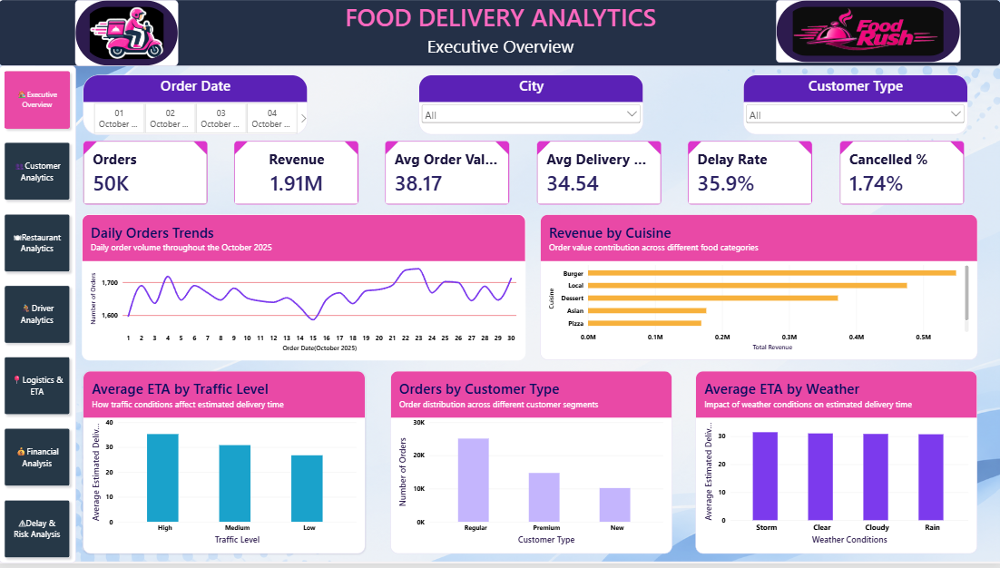
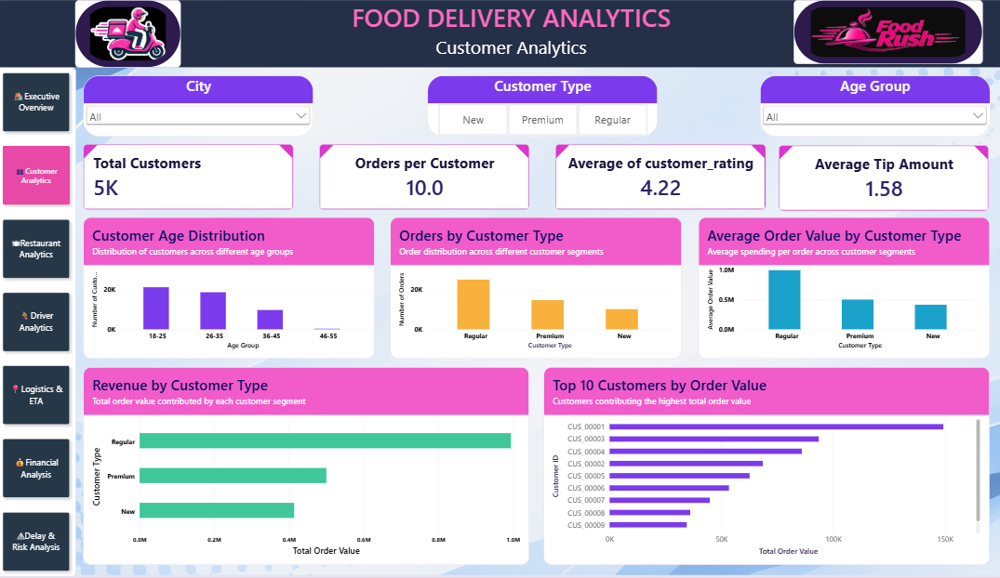
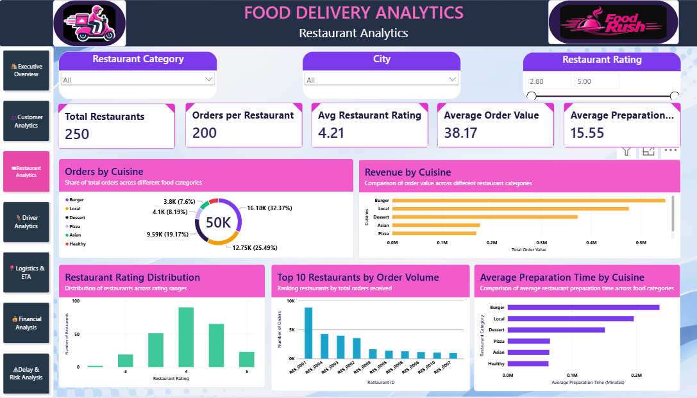
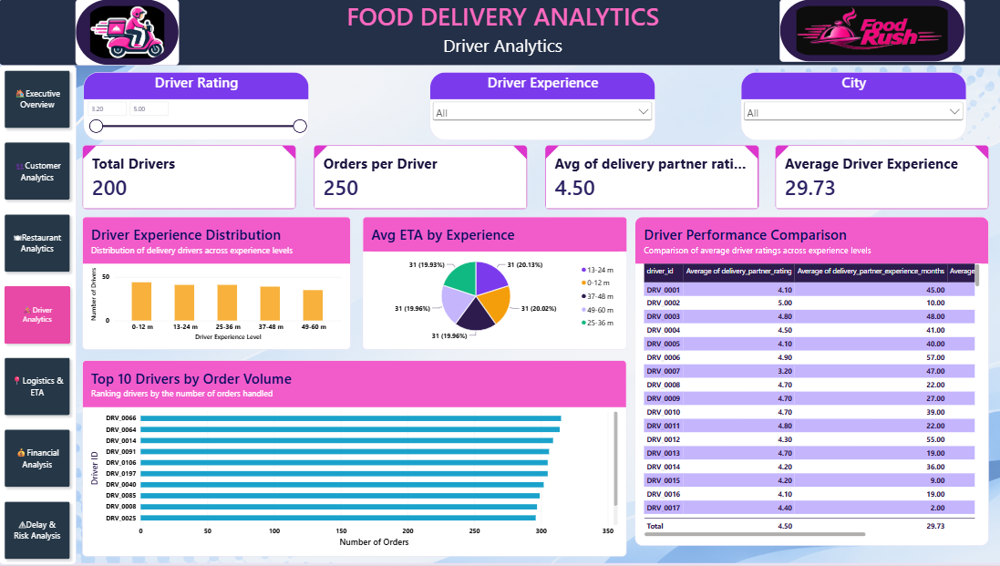
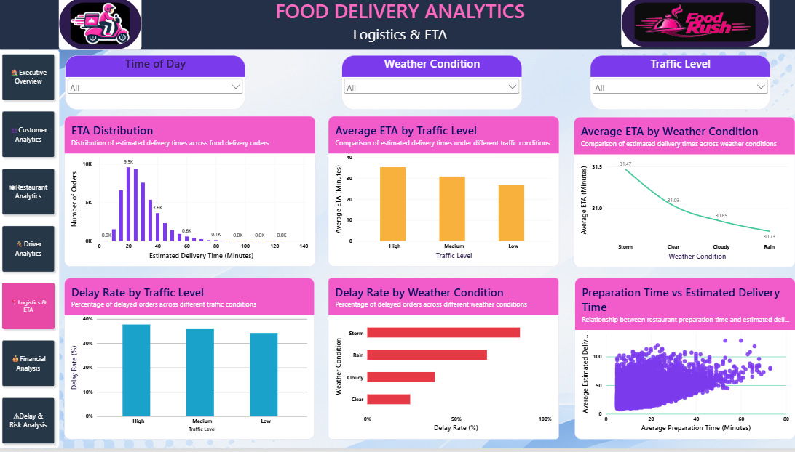
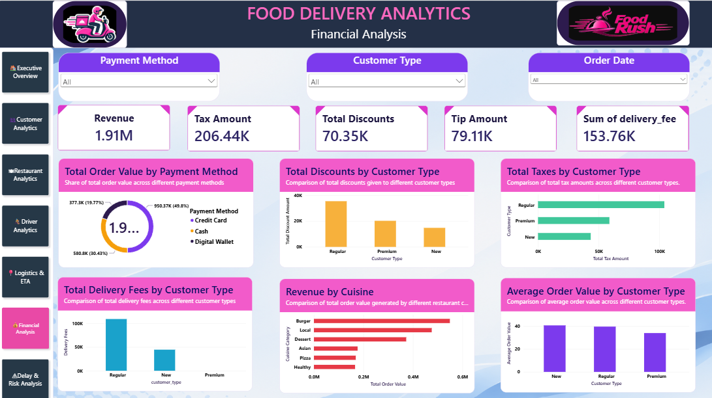
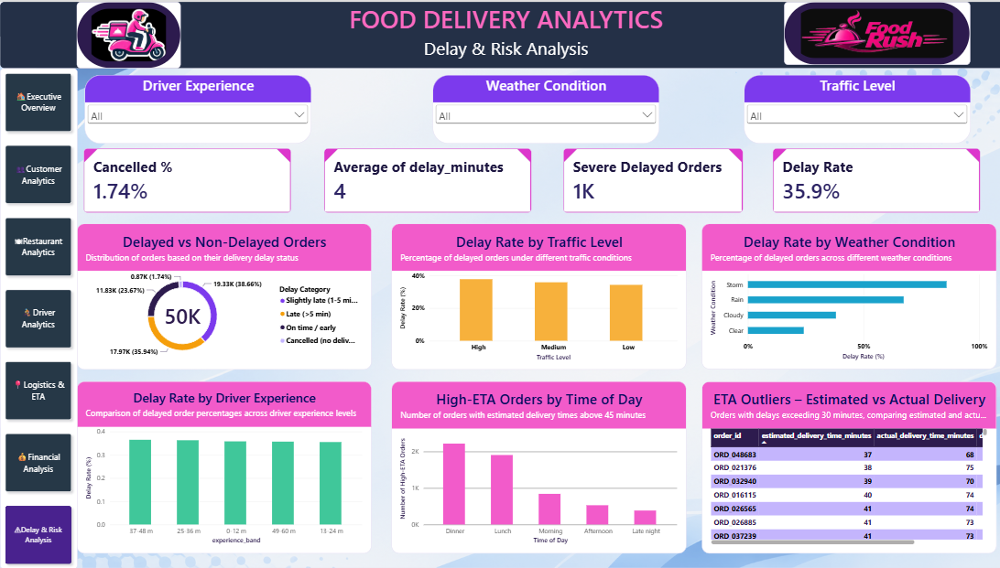

# food-delivery-eta-logistics-analysis
End-to-end food delivery analysis using Python, SQL and Power BI Analysis of 50,000 food delivery orders to find what drives delays and ETA, with a 7-page Power BI dashboard Food delivery orders and ETA logistics analysis: Python, MySQL, Power BI
# End-to-End Food Delivery Orders & ETA Logistics Analysis

An end-to-end data analytics project on **50,000 food delivery orders** from the platform **FoodRush**. It uses **Python**, **SQL (MySQL)** and **Power BI** to find out what drives delivery time, delays and revenue, and to recommend how to reduce late deliveries.


## Dashboard Screenshots









---

## Table of Contents

1. [Business Problem](#business-problem)
2. [Objectives](#objectives)
3. [Dataset](#dataset)
4. [Tools and Technologies](#tools-and-technologies)
5. [Project Workflow](#project-workflow)
6. [Power BI Dashboard](#power-bi-dashboard)
7. [Key Findings](#key-findings)
8. [Recommendations](#recommendations)
9. [Limitations](#limitations)
10. [Future Scope](#future-scope)
11. [Repository Structure](#repository-structure)
12. [Author](#author)

---

## Business Problem

Food delivery companies must deliver quickly, keep customers happy and control cost. Delivery time depends on many factors at once: restaurant preparation time, driver experience, traffic, weather, order size and delivery charges. Without joined-up analysis it is hard to see which factors really cause delays.

**Core question:** Which factors cause late deliveries and revenue leakage at FoodRush, and what should the company change to reduce them?

## Objectives

- Analyse overall order performance
- Understand customer segments and behaviour
- Evaluate restaurant and driver performance
- Analyse revenue, taxes, discounts, delivery fees and tips
- Measure the effect of traffic and weather on ETA and delay
- Detect unusual delivery times with the IQR method
- Build an interactive Power BI dashboard
- Prepare the data for future ETA and delay prediction

## Dataset

| Item | Detail |
| --- | --- |
| Records | 50,000 orders (one row per order) |
| Customers | 5,000 |
| Restaurants | 250 |
| Drivers | 200 |
| Period | October 2025 |
| Domains | Customer, restaurant, driver, weather and traffic, finance, delivery and ETA |

## Tools and Technologies

- **Python:** Pandas, NumPy, Matplotlib, Seaborn (cleaning, validation, EDA, outlier detection)
- **SQL:** MySQL (joins and aggregations)
- **Power BI:** Power Query, DAX measures, 7-page interactive dashboard
- **Git and GitHub:** version control

## Project Workflow

1. **Data loading and understanding:** shape, data types, summary statistics
2. **Data cleaning:** missing values, duplicates, standard column names, data types
3. **Data validation:** negative values, valid ranges, calculated total and delay minutes
4. **Exploratory data analysis:** distributions, relationships and correlations
5. **Outlier analysis:** IQR method (Q1 - 1.5 x IQR and Q3 + 1.5 x IQR)
6. **SQL analysis:** business questions answered with joins and GROUP BY
7. **Power BI dashboard:** KPIs, slicers and interactive visuals
8. **Insights and recommendations**

## Power BI Dashboard

The dashboard has seven pages with slicers on every page.

| Page | What it shows |
| --- | --- |
| **Executive Overview** | 50K orders, 1.91M revenue, 38.17 average order value, 34.54 min average delivery, 35.9% delay rate, 1.74% cancelled |
| **Customer Analytics** | 5K customers, 10.0 orders each, age distribution, segment revenue, top 10 customers |
| **Restaurant Analytics** | 250 restaurants, orders and revenue by cuisine, rating distribution, preparation time |
| **Driver Analytics** | 200 drivers, experience distribution, ETA by experience, top drivers by volume |
| **Logistics & ETA** | ETA distribution, ETA and delay rate by traffic and weather, preparation time vs ETA |
| **Financial Analysis** | Revenue, tax, discounts, tips, delivery fees, payment methods |
| **Delay & Risk** | Delay categories, delay by traffic, weather and experience, ETA outliers |

### Screenshots


## Key Findings

- **Stable demand, late delivery:** about 1,667 orders per day, but the delay rate is **35.9%** and only about 24% of orders arrive on time or early.
- **Demand is concentrated:** Burger, Local and Dessert make up **77%** of orders, and the top four restaurants handle about 42%.
- **Customers:** Regular customers bring about half of the revenue. Premium customers place about 30% of orders but bring only about 26% of revenue.
- **Weather drives delay:** the delay rate is about **24%** in clear weather and about **85%** in storms, yet the estimated delivery time changes by only **0.7 minutes**. The ETA effectively ignores weather.
- **Traffic is priced into ETA:** high traffic adds about 8 minutes to ETA, but the delay rate rises only a few points (about 34% to 38%).
- **Driver experience has no visible effect** on delay rate or ETA.
- **Peak hours carry the risk:** about 70% of orders with an ETA above 45 minutes occur at lunch and dinner.
- **Finance:** discounts are 3.7% of revenue, delivery fees add about 8%, and 30% of order value is paid in cash. Premium customers pay no delivery fee and have the lowest average order value.

> Some chart values are read from dashboard visuals and are approximate. KPI card values are exact.

## Recommendations

1. Make the ETA **weather-aware** with a delay buffer for rain and storms
2. Add driver capacity at **lunch and dinner** peaks
3. Reduce dependence on a few restaurants and monitor their preparation time
4. Review **Premium** customer economics (fee tiers or minimum baskets)
5. Allocate drivers by workload rather than tenure

## Limitations

- Data covers one month and may not represent every situation
- No GPS distance, live traffic or driver availability data
- Findings show association, not causation
- Some chart values are approximate

## Future Scope

- Machine learning ETA model (Random Forest, XGBoost) evaluated with MAE, RMSE and R-squared
- Delay prediction classifier
- Add distance, real-time weather and traffic data
- Automated Power BI refresh

## Repository Structure

Adjust the names below to match your folders.

```
food-delivery-eta-logistics-analysis/
├── README.md
├── images/          Dashboard screenshots
├── report/          Project report (Word or PDF)
├── presentation/    PowerPoint slides
├── powerbi/         Power BI file (.pbix)
├── sql/             SQL queries
└── python/          Cleaning and EDA code
```

## Author

**Lakshmi Prasanna Bathula**

Feedback and suggestions are welcome.
